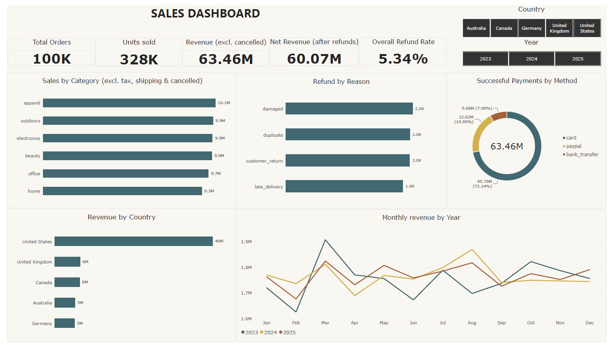

# E-commerce Sales Dashboard (Power BI)

## Overview
Power BI dashboard analysing e-commerce customers, orders, order items, payments, products and refunds.

## Dashboard Preview

[View full dashboard PDF](sales%20project.pdf)

## Dashboard Pages
1. Overview: orders, units sold, revenue, net revenue, refund rate, sales by category, refund reasons, payment methods, revenue by country and month
2. Product & Profit: sales, cost, profit and profit margin by category, product, customer segment and country
3. Year Comparison: year-over-year growth in revenue, profit and orders

## Data
CSV files in the dataset folder: customers, orders, order_items, payments, products, refunds.

## Tools
- Power BI
- DAX
- Power Query

## Features
- Date table with Year and Month Name for time analysis
- Country and Year slicers across pages
- Year-over-year comparison measures

## Files
- sales project.pbix: Power BI file
- sales project.pdf: full dashboard export
- dataset/: source CSV files
- Screenshots/: dashboard preview images
